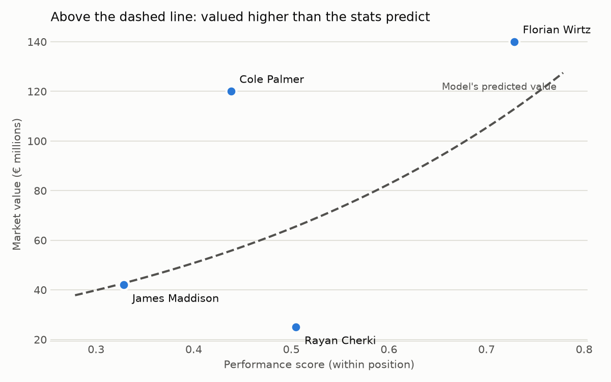

# Player Performance Transfer Model

Do a footballer's stats justify his market value? This project predicts a player's Transfermarkt value from his season stats and age, then shows who is over- or undervalued compared with the market.



Dots above the dashed line are valued higher than their stats suggest. Dots below it are valued lower. Example: Rayan Cherki is valued at about 45m, while the model predicts about 115m from his stats and age.

## How it works
1. **Collect:** `stats.py` pulls a player's season stats from API-Football.
2. **Build:** `building_training_data.py` sums his competitions, fuzzy-matches him to Transfermarkt, and attaches his market value (nearest 31 July after the season) and age.
3. **Score:** `linear_model.py` converts stats to per-90 rates, ranks players within their position, and weights the stats that matter for that position (for example, key passes and dribbles for attacking midfielders) into a score from 0 to 1. Cards reduce the score.
4. **Predict:** a linear regression turns score and age into a predicted value in millions of euros.

## Results (attacking midfielders, 2024/25, 11 players)
- R² = 0.44 (on the players the model was fitted to)
- Leave-one-out average error (predicting each player without seeing him):
  about 35m using score and age, about 31m using age alone, about 42m using score alone

With only 11 players, the performance score does not beat age at predicting value for
unseen players. More players per position is the main next step.

### Example: Rayan Cherki
Using his 2024/25 stats and age, the model predicted about 115m. Transfermarkt valued him at
45m (June 2025), so he showed up as the most undervalued player in the group.
By June 2026 his Transfermarkt value had risen to 90m.

| Date | Transfermarkt value |
|---|---|
| Jun 2025 (used in the model) | 45m |
| Dec 2025 | 50m |
| Mar 2026 | 65m |
| Jun 2026 | 90m |

This is a single example, not proof the model works. His move to Manchester City and
his club form will also have driven the rise, which the model cannot see.
## Run it
```
pip install -r requirements.txt
```
1. Get a free API-Football key and put `API_FOOTBALL_KEY=your_key` in a `.env` file (not committed).
2. `python stats.py` to collect players (free plan: seasons 2022 to 2024, about 100 requests a day).
3. `python building_training_data.py` to build `training_data.csv`.
4. `python linear_model.py` to fit the model and show the plot.

## Data
- [API-Football](https://www.api-football.com/): player stats
- [Transfermarkt dataset on Kaggle](https://www.kaggle.com/datasets/davidcariboo/player-scores): market values and player details

## Next steps
More players, and other positions (each position gets its own model).
